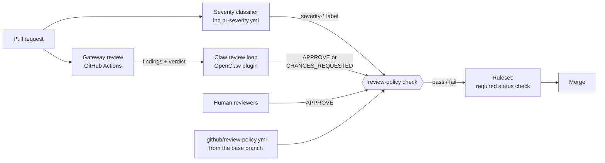
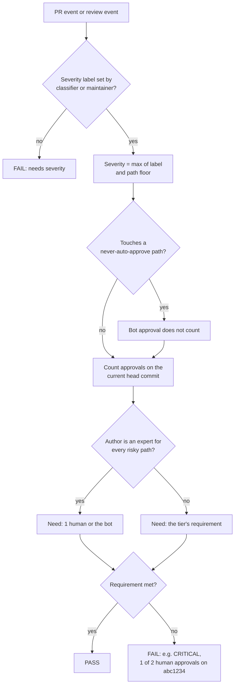
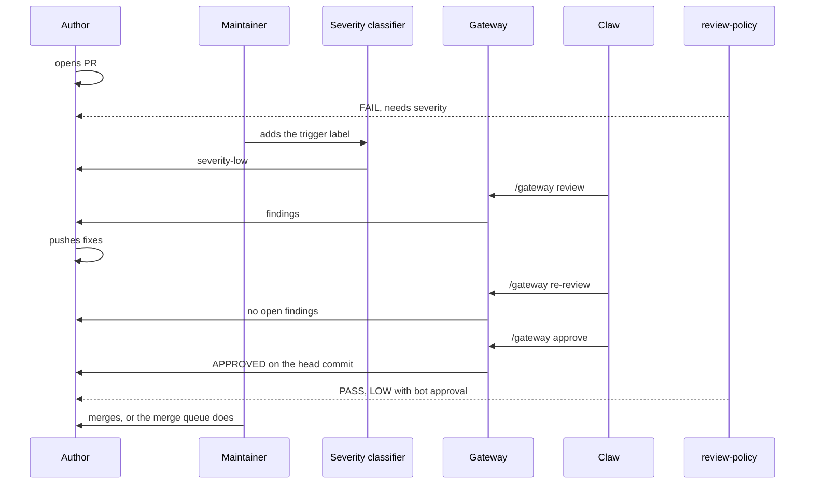

# review-policy

A required GitHub status check that decides whether a pull request has the
approvals it needs, based on how risky the PR is.

The repository ruleset asks for one approval. This check raises that bar for
riskier PRs. It makes no model calls and never runs PR code, and it reaches
the same answer every time for the same inputs.

> **Status:** design. The implementation is tracked in
> [#1](https://github.com/lightninglabs/review-policy/issues/1).

## The policy at a glance

| Severity | What it takes to merge |
| --- | --- |
| **LOW** | The bot approves after a clean Gateway review |
| **MEDIUM** | 1 human approval |
| **HIGH** | 1 human approval |
| **CRITICAL** | 2 different humans approve |
| **Expert author** | 1 human, or the bot, if every risky path the PR touches is in the author's listed domains |

The PR author never counts toward their own approvals.

## How the pieces fit



- **Severity classifier:** labels each PR's risk. A maintainer triggers it
  manually ([lnd#11424](https://github.com/lightningnetwork/lnd/issues/11424)).
- **Gateway:** reviews the code and reports findings.
- **Claw review loop:** follows Gateway through fixes, asks it to approve LOW
  PRs, and posts `CHANGES_REQUESTED` on higher tiers
  ([lightning-infra#4305](https://github.com/lightninglabs/lightning-infra/pull/4305)).
- **review-policy (this repo):** the gate. The bot's reviews are signals; this
  check is what makes the ruleset block or allow the merge.

## What the check decides



## A PR's life



On a HIGH PR, the claw posts `CHANGES_REQUESTED` instead of asking Gateway to
approve, and the check stays red until a human approves the current head.

## Why a required check and not just bot reviews

A bot's `CHANGES_REQUESTED` review only blocks a merge if the bot is running
and noticed the PR. A required check **fails closed**:

- If the bot is down, the check never passes, so nothing merges.
- A PR with no severity fails with "needs severity".
- A severity label applied by the wrong person doesn't count.
- Approvals given on an older commit don't count for HIGH and CRITICAL.

## Configuration

Each repository keeps its policy in `.github/review-policy.yml`. The check
always reads it from the **base branch**, so a PR cannot loosen the rules that
judge it.

```yaml
version: 1

# Accounts whose approvals count as "the bot", never as humans.
bots:
  - lightninglabs-gateway[bot]

# Minimum severity by path. The final severity is never lower than this.
floor:
  critical: ["channeldb/migration*/**", "sqldb/**", "lnwallet/**", "contractcourt/**"]
  high: ["htlcswitch/**", "routing/**", "peer/**"]

# Paths where a bot approval never counts, whatever the severity.
never_auto_approve:
  - ".github/**"
  - "scripts/**"
  - "go.mod"
  - "go.sum"
  - "**/AGENTS.md"
  - "**/CLAUDE.md"

tiers:
  low:      { humans: 0, bot: true }
  medium:   { humans: 1 }
  high:     { humans: 1, fresh: true }   # fresh: approvals must be on the current head
  critical: { humans: 2, fresh: true }

# Authors with domain expertise. Their PRs need 1 human or the bot,
# but only when every floored path they touch is inside their globs.
experts:
  alice: ["htlcswitch/**", "routing/**"]
```

Changing `.github/review-policy.yml` itself is always treated as CRITICAL.

## Rules the check enforces

| Input | Rule |
| --- | --- |
| Severity label | Counts only if the timeline shows it was applied by the classifier workflow or by someone with write access other than the PR author |
| Path floor | Severity = the higher of the label and the floor |
| Approvals | The latest review per reviewer; only `APPROVED` counts. For `fresh` tiers, the review must be on the current head commit. |
| Humans vs bots | Accounts in `bots` count only as the bot. The PR author never counts. |
| Experts | Applies only if the expert is the PR author and every floored path the PR touches matches one of their globs |
| Never auto-approve | If any changed path matches, a bot approval satisfies nothing |

## Using it in a repository

The check runs from a short workflow on `pull_request_target`, plus
`pull_request_review` so it re-evaluates when someone approves:

```yaml
name: review-policy
on:
  pull_request_target:
    types: [opened, synchronize, reopened, labeled, unlabeled, ready_for_review]
  pull_request_review:
    types: [submitted, dismissed]
permissions:
  contents: read
  pull-requests: read
  checks: write
jobs:
  policy:
    runs-on: ubuntu-latest
    steps:
      - uses: lightninglabs/review-policy@<sha>
```

This repository is public, so both public repositories such as lnd and
private ones such as wavelength can pin the action by commit SHA.

Then, in the repository ruleset:

1. Add `review-policy` as a **required status check**, with the GitHub Actions
   integration as its source, so another App cannot report it.
2. In the same change, set required approvals to **1**. The check supplies the
   second approval for CRITICAL. Lowering the count first would leave a window
   where CRITICAL needs only one approval.

Roll it out as a non-required check first and compare its verdicts with real
merges before making it required.

## Open questions

- After a new push, do LOW and MEDIUM approvals carry over when the new commits
  are themselves LOW?
- Should the expert list be per repository, or one shared org file?
- Which account approves for the bot? It needs to be separate from
  `litbot-9000`, which also opens PRs and cannot approve its own.

## Related

- [lnd#11424](https://github.com/lightningnetwork/lnd/issues/11424): severity
  scoring, with a path floor and calibration
- [lightning-infra#4305](https://github.com/lightninglabs/lightning-infra/pull/4305):
  the claw review loop that drives Gateway
- [keybase-claw#42](https://github.com/lightninglabs/keybase-claw/issues/42):
  the umbrella tracker for engineering automation
