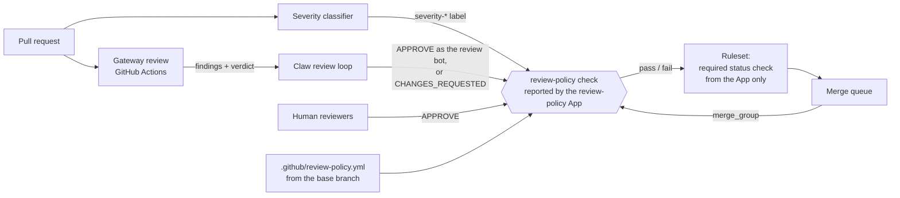
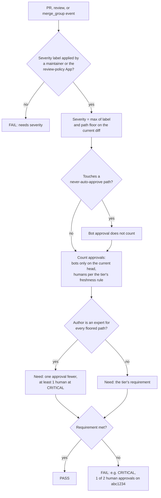
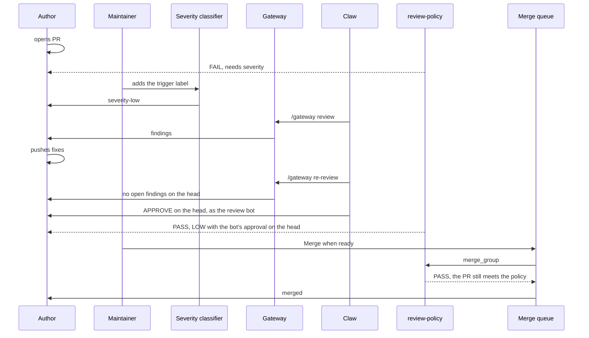

# review-policy

A required GitHub status check that decides whether a pull request has the
approvals it needs, based on how risky the PR is.

The repository ruleset asks for one approval. This check raises that bar for
riskier PRs. It makes no model calls and never runs PR code, and it reaches
the same answer every time for the same inputs.

> **Status:** v1 implemented (tracked in
> [#1](https://github.com/lightninglabs/review-policy/issues/1)). Not yet
> deployed to any repository.

## The policy at a glance

| Severity | What it takes to merge |
| --- | --- |
| **LOW** | The review bot approves the current head after a clean Gateway review |
| **MEDIUM** | 1 human approval |
| **HIGH** | 1 human approval on the current head |
| **CRITICAL** | 2 different humans approve the current head |
| **Expert author** | One approval fewer than the tier needs, and never fewer than 1 human at CRITICAL |

The PR author never counts toward their own approvals. A bot approval only
ever counts on the current head commit.

## How the pieces fit



- **Severity classifier:** labels each PR's risk. A maintainer triggers it
  manually ([lnd#11424](https://github.com/lightningnetwork/lnd/issues/11424)).
- **Gateway:** reviews the code and reports findings.
- **Claw review loop:** our OpenClaw bot. It follows Gateway through fixes,
  then approves LOW PRs as the **review bot** account, and posts
  `CHANGES_REQUESTED` on higher tiers.
- **review-policy (this repo):** the gate. The bot's reviews are signals; this
  check is what makes the ruleset block or allow the merge.

## Identities

Two identities make this work, and neither is the account that opens PRs:

| Identity | What it is | Why |
| --- | --- | --- |
| **Review bot** | A dedicated machine **user** with write access, listed in `bots` | GitHub counts only approvals from accounts with write access toward the ruleset's required approval. A GitHub App's `APPROVE`, such as Gateway's, does not count. It must not be `litbot-9000`, which also opens PRs and cannot approve its own. |
| **review-policy App** | A GitHub App with `checks: write`, `pull-requests: read`, and `contents: read` | Reports the check. The ruleset requires the check **from this App's integration id**, so no other workflow or App can satisfy it. |

The App's private key lives in an Actions environment whose deployment branch
policy allows only the default branch. Workflows that run from the default
branch (`pull_request_target`, `workflow_run`, `merge_group`) can use it. A
workflow that someone adds on their own branch, even a same-repo branch,
cannot. Reporting through the App also means fork PRs work: the write never
depends on the token of the event that triggered it.

## What the check decides



## A PR's life



On a HIGH PR, the claw posts `CHANGES_REQUESTED` instead of approving, and the
check stays red until a human approves the current head. If the author pushes
after the bot approved, the bot's approval stops counting; the claw re-reviews
the new head through Gateway and approves again only if it is clean.

## Why a required check and not just bot reviews

A bot's `CHANGES_REQUESTED` review only blocks a merge if the bot is running
and noticed the PR. A required check **fails closed**:

- If the bot is down, the check never passes, so nothing merges.
- A PR with no severity fails with "needs severity".
- A severity label applied by anyone other than a maintainer or the App
  doesn't count.
- Bot approvals on an older commit never count, and human approvals on an
  older commit don't count for HIGH and CRITICAL.
- Only the review-policy App can report the check the ruleset requires.

## Configuration

Each repository keeps its policy in `.github/review-policy.yml`. The check
always reads it from the **base branch**, so a PR cannot loosen the rules that
judge it.

```yaml
version: 1

# Accounts whose approvals count as "the bot", never as humans. Each must be
# a user with write access; App approvals do not count toward the ruleset.
bots:
  - "<review bot login>"

# Minimum severity by path, evaluated on the current diff. The final severity
# is never lower than this.
floor:
  critical: ["channeldb/migration*/**", "sqldb/**", "lnwallet/**", "contractcourt/**"]
  high: ["htlcswitch/**", "routing/**", "peer/**"]

# Paths where a bot approval never counts, whatever the severity.
never_auto_approve:
  - ".github/**"
  - "scripts/**"
  - "go.mod"
  - "go.sum"
  - "**/AGENTS.md"
  - "**/CLAUDE.md"

tiers:
  low:      { humans: 0, bot: true }
  medium:   { humans: 1, carry: low_only }   # see "Approvals after a push"
  high:     { humans: 1, fresh: true }       # fresh: approvals must be on the current head
  critical: { humans: 2, fresh: true }

# Authors with domain expertise in this repository's paths. Their PRs need
# one approval fewer than the tier requires, and CRITICAL always keeps at
# least one human, but only when every floored path they touch is inside
# their globs.
experts:
  alice: ["htlcswitch/**", "routing/**"]
```

Changing `.github/review-policy.yml` itself is always treated as CRITICAL and
is never auto-approved. Expert lists are per repository, because they are tied
to that repository's paths.

## Rules the check enforces

| Input | Rule |
| --- | --- |
| Severity label | Counts only if the timeline shows it was applied by a user with write access other than the PR author, or by the review-policy App on the classifier's behalf. Labels applied by `github-actions[bot]` do not count, since any workflow can act as it. |
| Path floor | Severity = the higher of the label and the floor, recomputed on the current diff after every push |
| Bot approvals | Only `APPROVED` reviews from `bots`, and **only on the current head commit**, in every tier |
| Human approvals | The latest review per reviewer; only `APPROVED` from users with write access counts. `fresh` tiers require the current head. |
| Approvals after a push | MEDIUM human approvals carry over only if every file changed since the approved commit is outside the floor and outside `never_auto_approve`. LOW and MEDIUM otherwise follow the rows above. |
| Experts | Applies only if the expert is the PR author and every floored path the PR touches matches one of their globs. Lowers the requirement by one, never below one human at CRITICAL. |
| Never auto-approve | If any changed path matches, a bot approval satisfies nothing |

### Implementation details

Where the design above leaves room, v1 does this:

- **Labels** are `severity-low`, `-medium`, `-high`, `-critical`. If several
  valid ones are present, the highest wins.
- **Approvers** must have write access to count as humans, as GitHub itself
  requires. `COMMENTED` reviews don't change a reviewer's latest state, as on
  GitHub; `CHANGES_REQUESTED` and dismissals do.
- **`bot: true`** on a tier adds one approval that the bot or another human can
  give. So LOW needs the bot or one human.
- **Experts** get relief only if the PR touches at least one floored path and
  doesn't edit the policy file.
- **The policy file** counts as a CRITICAL floored path and a
  never-auto-approve path, whatever the config says.
- **Globs** match whole paths: `**` is any number of directories, `*` and `?`
  stay inside one directory. A pattern without a slash, like `go.mod`, only
  matches at the root.
- **The config parser** is built in and accepts a strict YAML subset: block
  and flow mappings and lists, quoted and plain scalars, comments. Anchors,
  tags, and block scalars are errors. Unknown keys are errors, so a typo
  fails closed. Quote globs that start with `*`, and logins inside `[...]`
  lists, as YAML itself requires.
- **More than 3000 changed files**, the API's limit, fails the check.

## Merge queue

Required checks must report on `merge_group` events too, or queued PRs wait
for a result that never comes and the queue stalls.

On `merge_group`, the check takes the PR number from the queue ref
(`gh-readonly-queue/<base>/pr-<N>-<sha>`), re-evaluates that PR against the
policy on its head commit, and reports the result on the merge group's head
commit. A queue entry passes when its PR still meets the policy. Approvals and
labels are not re-collected from the queue commit, since the queue commit has
no reviews of its own.

## Using it in a repository

Two short workflows, both running from the default branch:

```yaml
# .github/workflows/review-policy.yml
name: review-policy
on:
  pull_request_target:
    types: [opened, synchronize, reopened, labeled, unlabeled, ready_for_review]
  merge_group:
  workflow_run:
    workflows: [review-policy-relay]
    types: [completed]
  workflow_dispatch:
    inputs:
      pr: { required: true }
permissions:
  contents: read
jobs:
  policy:
    runs-on: ubuntu-latest
    environment: review-policy   # holds the App key; default branch only
    steps:
      - uses: lightninglabs/review-policy@<sha>
        with:
          app_id: ${{ vars.REVIEW_POLICY_APP_ID }}
          private_key: ${{ secrets.REVIEW_POLICY_APP_KEY }}
```

```yaml
# .github/workflows/review-policy-relay.yml
# Review events run with a read-only token on fork PRs, so this workflow only
# records that a review happened. The workflow_run above does the evaluation.
name: review-policy-relay
on:
  pull_request_review:
    types: [submitted, dismissed]
permissions: {}
jobs:
  relay:
    runs-on: ubuntu-latest
    steps:
      - run: echo "review on PR ${{ github.event.pull_request.number }}"
```

Then, in the repository ruleset, in **one** change:

1. Add `review-policy` as a **required status check**, with the review-policy
   App as its source.
2. Keep required approvals at **1**. The review bot's approval satisfies it on
   LOW, a human's on every other tier, and the check supplies the second human
   for CRITICAL.
3. Lower required approvals from 2 to 1 only in this same change, if the repo
   currently requires 2.

Roll it out as a non-required check first and compare its verdicts with real
merges before making it required.

## Development

```sh
node --test test/*.test.mjs   # unit and end-to-end tests, no network
node scripts/build.mjs        # rebuild dist/ after changing src/
```

`src/policy.mjs` is the pure evaluation; `src/main.mjs` does the GitHub I/O.
The tests fail if `dist/` is out of date.

## Open questions

- Should a push invalidate the severity label itself, forcing reclassification?
  Today the floor is recomputed on every push and bot approvals must be on the
  head, which covers the LOW path; a stricter option is to treat a label
  applied before the latest push as stale.
- Who creates and owns the review bot user and the review-policy App?

## Related

- [lnd#11424](https://github.com/lightningnetwork/lnd/issues/11424): severity
  scoring, with a path floor and calibration
- The claw review loop that drives Gateway and posts the review bot's reviews
  lives in Lightning Labs' internal bot repositories.
